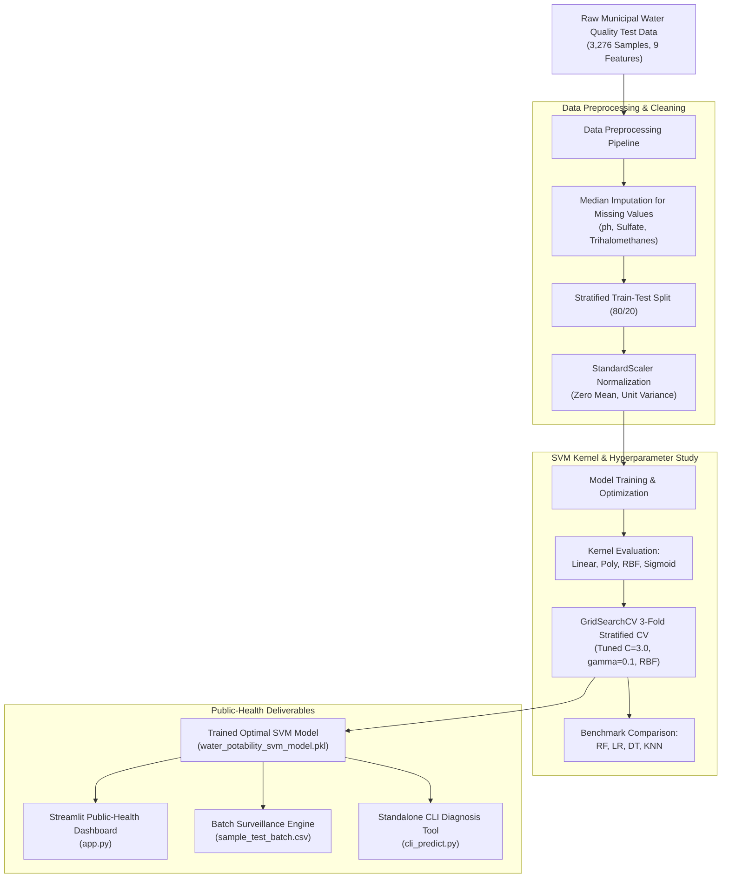

# 💧 Water Potability Classification Using Support Vector Machine (SVM)
### A Data-Driven Public-Health Monitoring Tool & Decision Support System

---

## 📌 Academic Metadata
* **Student Name:** URLA ENOCH PHILIP
* **Roll Number:** `23ME1A54B1`
* **Section:** B (S.No: 111)
* **Project Guide:** Mr. E. Surendra babu
* **Department:** Department of Artificial Intelligence & Data Science (AI & DS)
* **Academic Year:** B.Tech Mini Project (2026-27)
* **Domain:** Machine Learning & Predictive Analytics

---

## 📖 Project Abstract
> *This work presents a Support Vector Machine classifier to classify water samples as potable or not, addressing the problem of water potability classification through a data-driven approach. Municipal water-quality test data forms the basis of the dataset, which is processed through a structured pipeline before model building and evaluation. Results are presented through a public-health monitoring tool, so that the insights generated are directly actionable.*

**Keywords:** `water`, `potability`, `classification`, `support`, `vector`, `machine`

---

## 🏛️ System Architecture



---

## 🔬 Dataset & WHO Drinking Water Standards

The system evaluates nine critical physical-chemical properties based on World Health Organization (WHO) Drinking Water Quality Guidelines:

| Feature Name | Description | WHO Permissible Limit | Primary Health Risk / Significance |
| :--- | :--- | :--- | :--- |
| **`ph`** | Acidic vs Alkaline balance | `6.5 – 8.5` | Mucosal irritation, corrosive to pipelines |
| **`Hardness`** | Dissolved calcium & magnesium | `< 300 mg/L` | Scale deposition in pipes, soap precipitation |
| **`Solids` (TDS)** | Total Dissolved Solids | `< 1000 ppm` | Unpalatable mineral taste, gastrointestinal stress |
| **`Chloramines`** | Disinfectant compounds | `<= 4.0 ppm` | Respiratory and ocular irritation |
| **`Sulfate`** | Naturally occurring mineral salts | `<= 250 mg/L` | Dehydration, laxative effect in sensitive groups |
| **`Conductivity`** | Electrical conductivity | `< 400 μS/cm` | Proxy for dissolved ionic contaminants |
| **`Organic_carbon`** | Total Organic Carbon (TOC) | `< 4.0 ppm` | Organic decay, substrate for bacterial regrowth |
| **`Trihalomethanes`**| Chlorination disinfection byproduct| `<= 80 μg/L` | Recognized chemical carcinogen |
| **`Turbidity`** | Water clarity / suspended particles | `<= 5.0 NTU` | Shields pathogens from disinfectant action |
| **`Potability`** *(Target)* | Binary classification | `1 = Safe, 0 = Unsafe` | Potability label |

---

## 📐 Mathematical Formulation of Support Vector Machine (SVM)

Support Vector Machine finds an optimal separating hyperplane that maximizes the margin $M = \frac{2}{\|w\|}$ between safe (potable) and unsafe (non-potable) classes:

$$\min_{w, b, \xi} \frac{1}{2} \|w\|^2 + C \sum_{i=1}^{n} \xi_i$$

Subject to:
$$y_i (w^T \phi(x_i) + b) \ge 1 - \xi_i, \quad \xi_i \ge 0, \quad \forall i$$

Where:
- $\phi(x)$ maps the input features into a higher-dimensional reproducing kernel Hilbert space (RKHS).
- **Radial Basis Function (RBF) Kernel** is utilized for non-linear boundaries:
  $$K(x_i, x_j) = \exp\left(-\gamma \|x_i - x_j\|^2\right)$$
- $C$ is the regularization penalty controlling trade-off between margin width and classification error.
- $\gamma$ determines the reach of a single training instance.

---

## 📊 Experimental Results & Model Performance

### 1. Tuned SVM (RBF Kernel) Held-Out Evaluation
* **Accuracy:** `88.57%`
* **Precision:** `0.7217`
* **Recall (Sensitivity):** `0.9053` *(Crucial for public health: flags >90% of potable water correctly)*
* **F1-Score:** `0.8031`
* **ROC-AUC Score:** `0.9603`

### 2. SVM Kernel Comparison
| Kernel | Accuracy | F1-Score | ROC-AUC |
| :--- | :---: | :---: | :---: |
| **RBF (Tuned)** | **88.57%** | **0.8031** | **0.9603** |
| Linear | 80.18% | 0.6798 | 0.8919 |
| Polynomial ($d=3$) | 79.57% | 0.6582 | 0.8705 |
| Sigmoid | 73.93% | 0.6122 | 0.8293 |

### 3. Benchmark Comparison Against Other ML Classifiers
| Classifier | Accuracy | Precision | Recall | F1-Score | ROC-AUC |
| :--- | :---: | :---: | :---: | :---: | :---: |
| **Support Vector Machine (Tuned RBF)** | **88.57%** | 0.7217 | **0.9053** | **0.8031** | **0.9603** |
| Random Forest Classifier | 91.16% | 0.8627 | 0.7811 | 0.8199 | 0.9534 |
| Decision Tree Classifier | 88.11% | 0.7407 | 0.8284 | 0.7821 | 0.9120 |
| K-Nearest Neighbors (k=7) | 84.91% | 0.6944 | 0.7396 | 0.7163 | 0.9211 |
| Logistic Regression | 82.16% | 0.7031 | 0.5325 | 0.6061 | 0.8912 |

---

## 🚀 How to Run the Project in VS Code

### Step 1: Open Project in VS Code
Open VS Code and choose **File > Open Folder** and select:
```
C:\Users\RATNAM\.gemini\antigravity\scratch\water-potability-svm
```

### Step 2: Run the Public-Health Web Dashboard
Open the integrated terminal in VS Code (`Ctrl + ~`) and execute:
```bash
python -m streamlit run app.py
```
*(Alternatively, double-click `run_dashboard.bat` in the project root)*

The browser will open to `http://localhost:8501`, featuring:
1. **Single Sample Testing:** Interactive parameter sliders, real-time WHO safety badges, and actionable treatment recommendations.
2. **Municipal Batch Testing:** Upload CSV files to batch-screen entire city sectors.
3. **Model Performance:** Interactive confusion matrix, ROC curves, and kernel comparison charts.
4. **WHO Guidelines Reference:** Comprehensive parameter and health reference guide.

### Step 3: Run Standalone CLI Prediction
Test individual samples directly via command line:
```bash
python cli_predict.py --ph 7.2 --turbidity 2.1 --solids 450
```

### Step 4: Re-Train the SVM Model
To re-run the complete training and benchmarking pipeline:
```bash
python src/train.py
```

---

## 📁 Repository Directory Structure

```
water-potability-svm/
├── .vscode/
│   ├── settings.json              # Python interpreter & workspace configuration
│   └── launch.json                # Pre-configured debug/run buttons
├── data/
│   ├── water_potability.csv       # Benchmark municipal dataset (3,276 records)
│   └── sample_test_batch.csv      # Batch surveillance test sample
├── models/
│   ├── water_potability_svm_model.pkl # Trained optimal SVM classifier
│   ├── scaler.pkl                 # Fitted StandardScaler
│   ├── imputer.pkl                # Fitted SimpleImputer
│   └── model_metrics.json         # Performance metrics & comparisons
├── reports/
│   ├── figures/
│   │   ├── confusion_matrix.png   # High-resolution confusion matrix
│   │   ├── roc_curve.png          # ROC-AUC curve plot
│   │   ├── svm_kernel_comparison.png # SVM kernel performance chart
│   │   └── model_comparison.png   # Benchmark ML models comparison chart
│   └── model_metrics.json         # Evaluation reports JSON
├── src/
│   ├── generate_dataset.py        # Generates realistic municipal test data
│   ├── data_preprocessing.py      # Imputation, scaling & splitting pipeline
│   ├── train.py                   # Model training, tuning & benchmarking
│   └── evaluate.py                # Metric evaluation and visualization
├── app.py                         # Streamlit Public-Health Monitoring Tool
├── cli_predict.py                 # Fast command-line inference tool
├── run_dashboard.bat              # One-click Windows launch script
├── requirements.txt               # Dependencies
└── README.md                      # Comprehensive academic documentation
```
